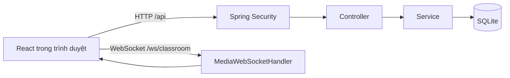

# Bản đồ học bản web

Phạm vi tài liệu này chỉ gồm React trong trình duyệt, Spring Boot ở máy chủ, SQLite và WebSocket media. Mã Swing/TCP/UDP cũ nằm ngoài phạm vi.

## Sơ đồ đường đi

## Thứ tự học

1. `web/src/main.tsx`: React khởi động, giữ `user`, `token`, `rooms` trong state.
2. `web/src/api.ts`: một hàm `api()` dùng chung cho mọi request; token được gửi trong `Authorization: Bearer ...`.
3. `backend/src/main/java/com/pbl4/web/ApiController.java`: nhận `/api/auth/login`, gọi `AuthService`, rồi trả user và token.
4. `backend/src/main/java/com/pbl4/web/SecurityConfig.java`: kiểm tra Bearer token cho các API riêng tư.
5. `backend/src/main/java/com/pbl4/web/ClassroomService.java`: quyết định quyền theo từng lớp, không dùng role toàn cục để cho phép quản lý lớp.
6. `backend/src/main/java/com/pbl4/web/Database.java`: lưu phiên, lớp, thành viên, buổi học và lượt kết nối trong SQLite.
7. `web/src/ClassroomMedia.tsx` và `backend/src/main/java/com/pbl4/web/MediaWebSocketHandler.java`: xin vé ngắn hạn, mở socket, rồi chuyển tiếp ảnh màn hình và âm thanh.
8. Các file `backend/src/test/...` và `web/test/...`: đọc test theo hành vi, không chỉ theo tên lớp.

## Bài 1: lần theo đăng nhập

Mở `web/src/main.tsx` và tìm `submit`.

- Form lấy `username` và `password` bằng `FormData`.
- `api('/auth/login', 'POST', credentials)` gửi request đến `/api/auth/login`.
- Khi server trả `user` và `token`, React gọi tiếp `/rooms`, rồi chạy `setUser`, `setToken`, `setRooms`.
- JSX dùng `!user` để chọn màn hình đăng nhập; có user thì render `Classes`.

Sau đó mở `web/src/api.ts`:

- `fetch('/api' + path, ...)` nối tiền tố API.
- Nếu có token, hàm thêm header Bearer.
- HTTP 401 phát sự kiện `pbl4-session-expired`, khiến `App` xóa state phiên.

Cuối cùng mở `ApiController.java`, `AuthService.java` và `SecurityConfig.java`:

- `ApiController.login` gọi `AuthService.login`.
- `AuthService` tạo token ngẫu nhiên dạng opaque; database chỉ lưu hash token và thời điểm hết hạn.
- Cookie `pbl4_restore` chỉ giúp khôi phục token vào bộ nhớ React khi tải lại trang.
- Cookie không tự cấp quyền ghi API; các request riêng tư vẫn cần Bearer token.

## Bài tập ngắn

1. Đặt breakpoint ở dòng gọi `api('/auth/login'...)` trong `main.tsx`.
2. Mở DevTools → Network và đăng nhập bằng tài khoản thử nghiệm.
3. Xem thứ tự request: `POST /api/auth/login`, sau đó `GET /api/rooms`.
4. Mở request `/api/rooms`, kiểm tra header `Authorization`.
5. Trả lời: nếu xóa `setToken(response.token)`, vì sao request `/rooms` sau đó thất bại?

## Ba khái niệm cần giữ riêng

- **Lớp**: danh sách thành viên lâu dài.
- **Buổi học**: một lần mở lớp để học; có thể có nhiều buổi cho cùng lớp.
- **Kết nối**: một WebSocket của một tab trình duyệt; rời buổi chỉ đóng kết nối.

Dashboard: mở URL được in trong terminal của Codex, rồi bắt đầu bằng tour `Overview` hoặc `Login`.
