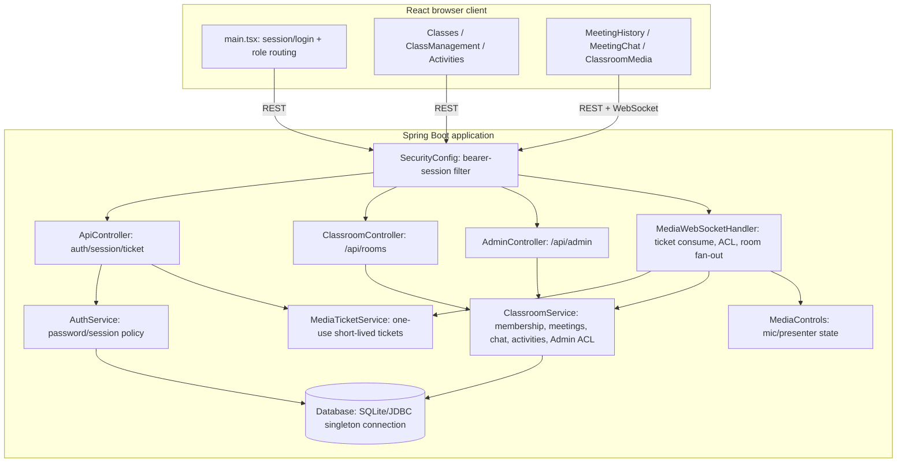

# Architecture Audit — PBL4 Classroom

**Phiên bản được đọc:** `codex/trung-tuong-2026-11-22`, `a6cabab9bb26c0f44644f44ec2bda47fb787d78e`.
**Phương pháp:** đọc mã nguồn/tài liệu, kiểm tra test results; xác thực mô hình C4 bằng Structurizr DSL parser. Không thay đổi code hoặc cấu hình.

## C4 Level 1 — System Context

```mermaid
flowchart LR
  Admin[Person: Admin]
  Teacher[Person: Teacher / chủ lớp]
  Student[Person: Student / thành viên]
  P4["System: PBL4 Classroom<br/>Lớp học web, quản trị lớp, chat và media relay"]
  Admin -->|HTTP(S), HTTPS for LAN: quản lý toàn bộ lớp| P4
  Teacher -->|HTTP(S), HTTPS for LAN: điều hành lớp mình| P4
  Student -->|HTTP(S), HTTPS for LAN: xin vào lớp, học và trao đổi| P4
```

Admin và Teacher được cấp bằng lệnh operator cục bộ (`OperatorCommand.java:13-22`); public registration tạo tài khoản thường (`AuthService.java:38-47`). Vai trò owner/member nằm theo quan hệ từng lớp, không chỉ theo role toàn cục.

## C4 Level 2 — Containers

```mermaid
flowchart LR
  Admin[Person: Admin]
  Teacher[Person: Teacher / chủ lớp]
  Student[Person: Student / thành viên]
  subgraph P4[System: PBL4 Classroom]
    Browser["Container: Browser client<br/>React + TypeScript<br/>UI, capture audio/screen"]
    App["Container: Java application<br/>Spring Boot<br/>REST + authentication + business services + WebSocket relay"]
    DB[("Container: SQLite file<br/>accounts, classrooms, memberships, meetings, messages, activities")]
  end
  Admin -->|HTTP(S); HTTPS for LAN| Browser
  Teacher -->|HTTP(S); HTTPS for LAN| Browser
  Student -->|HTTP(S); HTTPS for LAN| Browser
  Browser -->|REST API over HTTP(S)\nWebSocket over TCP for chat/media| App
  App -->|JDBC, synchronized transaction| DB
```

Trong production prototype, React build được nhúng vào JAR qua tài nguyên Maven (`backend/pom.xml`); server mặc định bind loopback và DB mặc định là `./data/classroom-web.db` (`application.properties`). LAN HTTPS/proxy chưa được xác minh. `docs/WEB_MEDIA_DEMO.md:50-80` mô tả relay, giới hạn hàng đợi và TCP head-of-line blocking.

## C4 Level 3 — Components trong application server



The browser-to-API path is represented as REST. The WebSocket handshake bypasses bearer-filter identity and authenticates with a one-use query ticket; the ticket is first issued through authenticated `POST /api/media/ticket` (`ApiController.java:34`, `MediaTicketService.java:20-36`).

## Truy vết luồng chính

### A. Đăng nhập và khôi phục phiên

1. React gửi `/api/auth/login` (`web/src/main.tsx:20-35`).
2. `AuthService.login` tra account, so BCrypt, áp dụng throttle, tạo token ngẫu nhiên và lưu SHA-256 hash với expiry 8 giờ (`AuthService.java:49-59`).
3. API trả bearer token và đặt HttpOnly/SameSite Strict restore cookie (`ApiController.java:21-32`). Cookie chỉ dùng để nạp token vào bộ nhớ client; security filter yêu cầu `Authorization: Bearer` cho API còn lại (`SecurityConfig.java:22-48`).

### B. Xin vào lớp và quyền owner/member

1. Student gửi invite code đến `/api/rooms/join-requests`; `requestJoin` tìm lớp ACTIVE và tạo PENDING (`ClassroomController.java:36-39`, `ClassroomService.java:333-344`).
2. Owner duyệt; add member và cập nhật yêu cầu chạy trong transaction (`ClassroomService.java:263-265,363-369`).
3. Mọi read/media access gọi guard `access`: owner hoặc account trong `classroom_members`, và lớp phải ACTIVE (`ClassroomService.java:43-50`). Admin dùng endpoint riêng và guard role ADMIN (`AdminController.java:17-22`, `ClassroomService.java:28,52-69`).

### C. Meeting, media ticket và relay

1. Owner bắt đầu meeting; `setMeeting` tạo `meeting_sessions`/mở state (`ClassroomController.java:33-35`, `ClassroomService.java:107-113`).
2. Client đăng ký ticket qua REST. Ticket ngẫu nhiên, chỉ hash ticket lưu trong map, dùng một lần và hết hạn sau 30 giây (`MediaTicketService.java:20-36`).
3. Socket consume ticket, áp giới hạn 128 connections, 4096-byte text, 1.5MB screen frame; `join` xác nhận session, membership, meeting id (`MediaWebSocketHandler.java:46-74,97-105`).
4. Audio/screen được lọc quyền mic/presenter, rồi broadcast đến peer khác cùng room. Mỗi peer có single-writer queue 32 message, ngắt khi queue vượt 2MiB (`MediaWebSocketHandler.java:107-145`).
5. DB lưu chat/meeting/member history. Restart đóng meeting còn mở và đánh dấu lượt kết nối chưa kết thúc là interrupted (`Database.java:103-106`). Owner heartbeat timeout 10 phút đóng meeting (`ClassroomService.java:115-127`).

## Đánh giá thiết kế

- **Phân lớp:** monolith gọn, phù hợp prototype nhóm nhỏ: UI React, REST controllers, services, DB và WebSocket handler tách theo vai trò. Nhưng `ClassroomService` mang nhiều domain (Admin, membership, meeting lifecycle, chat, activities); một số controller/handler có logic nghiệp vụ và synchronization khá dày.
- **Database:** SQLite không cần dịch vụ riêng, prepared statements và foreign keys được bật, `busy_timeout=5000` (`Database.java:29-36`). Một `Connection` dùng chung và `synchronized transaction` serialize request DB (`Database.java:20-27`); phù hợp demo đơn tiến trình, không chứng minh scale/out-of-process coordination.
- **Concurrency:** peer maps thread-safe và mỗi receiver có bounded queue, nhưng callback `handleTextMessage`/`handleBinaryMessage` và connection operations đồng bộ trên một handler singleton (`MediaWebSocketHandler.java:46,53,97,200-215`). Trong binary fan-out, loop kiểm tra từng recipient bằng `valid()` trước khi enqueue (`:123-125`, `:129-135`); bước này có thể thực hiện nhiều truy vấn DB trong vùng khóa chung. Vì vậy các phòng không thực sự xử lý độc lập về mặt nhận/relay.
- **Transport:** Audio + screen đi cùng WebSocket/TCP, nên mất/giao hàng chậm một TCP segment có thể chặn các frame sau. Không phải WebRTC/SFU/P2P. Thử chat WebSocket thật đã đạt; âm thanh/màn hình vật lý và latency chưa thử.
- **Lifecycle:** meeting ID tách theo buổi, đóng khi owner end/archive/restart/timeout; memberships tồn tại sau kết thúc. Admin có thể archive/restore, đổi owner và transfer member. Việc chuyển owner chấm dứt meeting hiện tại và chuyển owner cũ sang member (`ClassroomService.java:293-331`). Không có audit log riêng cho các thao tác Admin.
- **Deployment:** static UI và server nằm trong một JAR; DB file relative với working directory. Server loopback default an toàn cho local; LAN requires trusted TLS/proxy and explicit origin. Không có bằng chứng từ lượt này về backup/restore DB thực tế.

## Rủi ro kiến trúc ưu tiên

1. **P1 — nghẽn toàn cục trên WebSocket + SQLite:** global monitor, DB single connection, và DB membership check trong fan-out. Trước khi tuyên bố hỗ trợ nhiều lớp đồng thời, cần workload đo được và thiết kế khóa/DB phù hợp.
2. **P2 — giới hạn prototype cố định:** 128 peers/process, 2MiB queue/peer, SQLite 1 writer connection. Không được diễn giải các giới hạn này thành capacity test.
3. **P2 — TCP head-of-line:** audio/screen tranh cùng socket. Muốn khẳng định chất lượng voice qua mạng thật phải đo; thay WebRTC/SFU là quyết định ngoài phạm vi audit.
4. **P2 — không có admin audit trail:** owner transfer, archive/restore, transfer member không có lịch sử ai/when/why riêng. Chỉ thêm nếu giảng viên/nghiệp vụ cần.
5. **P2 — schema migration chưa chứng minh rollback data:** migration chạy trên DB được chỉ định và đóng meeting open lúc khởi động. Bản sao DB trước khi chạy phiên bản mới cần do nhóm xác nhận thủ công.

## Ghi chú kiểm chứng

Structurizr DSL của Context/Container model được gửi qua validator và trả `OK`. Chưa tạo ảnh sơ đồ raster; hai sơ đồ Mermaid trên là mô hình được xác nhận theo cấu trúc code, không phải sơ đồ runtime tự sinh từ tracing.

## Cập nhật giao diện và Admin

Sau baseline audit, cùng nhánh đã bổ sung Admin API liệt kê người dùng/nâng Student thành Teacher và tạo lớp có Teacher owner. Auth vẫn đi qua session bearer, quyền Admin vẫn được kiểm tra ở service; public registration không cho tự chọn role. Không phát sinh container hoặc database mới: UI vẫn là React bundle nhúng trong JAR, Spring Boot vẫn phục vụ API/SQLite/WebSocket.

Frontend hiện dùng design tokens Lumina EdTech: nền sáng, royal blue primary, sky secondary, amber accent, Plus Jakarta Sans, controls có states chung. Đây là thay đổi trình bày; không bổ sung social sign-in hoặc remember-me từ HTML tham khảo. Việc nghiệm thu bằng mắt được thực hiện bằng Chromium ở desktop/mobile với API mock cho login, Admin dashboard và Student list; điều này không thay thế kiểm thử bằng người dùng/thiết bị thật.
